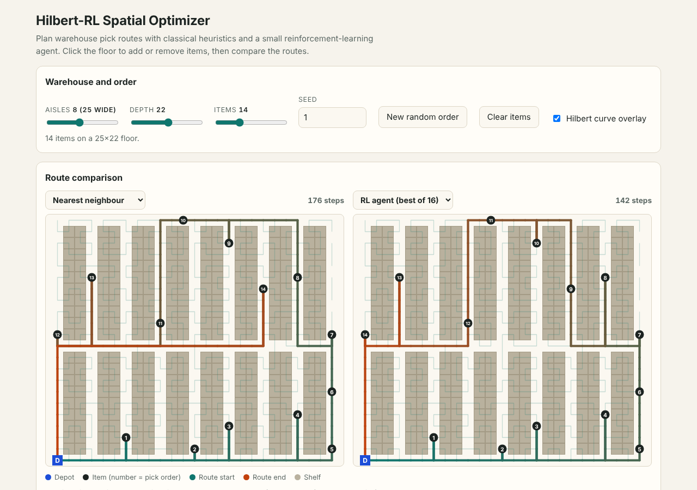

# Hilbert-RL Spatial Optimizer

[](https://github.com/poojabhavsar28/hilbert-rl-optimizer/actions)
[](https://github.com/poojabhavsar28/hilbert-rl-optimizer)
[](https://www.python.org)
[](LICENSE)
[](https://github.com/astral-sh/ruff)

> **Reinforcement learning for warehouse spatial optimization, using Hilbert space-filling curves for state representation and experience replay, with reproducible benchmarks of what helps and what doesn't.**



---

## The Core Idea

Standard RL gives a neural network raw `(x, y)` coordinates. The network has no way to know that `(0.50, 0.50)` and `(0.51, 0.50)` are neighbours — it has to learn that from scratch through millions of samples.

**Hilbert encoding solves this.** A Hilbert space-filling curve maps any N-dimensional space to a 1D index that *preserves locality* — nearby points in 2D space get nearby indices. The neural network learns spatial relationships for free, from the very first episode.

```
Standard RL:   state = [0.50, 0.50]   ← no spatial structure
Hilbert RL:    state = [0.6821]       ← nearby points → nearby values
```

**The Hilbert Replay Buffer** (this project's key contribution) extends this idea to experience sampling: instead of sampling past experiences uniformly, it samples experiences from spatially nearby states — the agent learns local policies faster.

> **Status of this idea.** The locality property is verified (every step along the curve moves exactly one cell, versus up to 32 cells for Z-order on a 32×32 grid; `tests/test_locality.py`). Whether it *helps learning* is a hypothesis this repository tests rather than a result it has shown: so far each Hilbert component has matched or lost to a simpler alternative (see [Results](#results)). Stable-Baselines3 PPO/SAC agents are not implemented yet, so the claims about them are untested.

---

## Results

Everything in this section is reproducible with the commands shown and recorded in [`docs/results/`](docs/results/) (OR-Tools needs `pip install ortools`, included in `requirements-api.txt` and the `solvers` extra). Distances are walking steps around shelves for a round trip from the depot.

### Routing quality (held-out warehouses, 40 random orders per size)

The agent is trained on five layouts and evaluated on three it has never seen. The reference is the exact optimum for ≤12 items, and above that the better of 2-opt and Google OR-Tools per order. Values are % longer than the reference (lower is better). `make benchmark`

| Items | S-shape | Nearest neighbour | Hilbert sort | **RL greedy** | **RL best-of-16** | 2-opt | **OR-Tools** |
|---:|---:|---:|---:|---:|---:|---:|---:|
| 8 | +23.5% | +11.0% | +33.2% | +4.2% | +0.6% | +0.8% | **0 (optimal)** |
| 12 | +31.9% | +13.0% | +48.5% | +6.4% | +1.0% | +1.0% | **0 (optimal)** |
| 20 | +46.2% | +15.9% | +56.3% | +7.4% | +3.3% | +2.9% | **0 (ref)** |
| 30 | +46.4% | +15.0% | +57.7% | +9.9% | +6.4% | +2.5% | **+0.1%** |

**Google OR-Tools is the best method here.** It matches the exact optimum up to 12 items and is 3 to 6 points shorter than the learned agent at 20 to 30 items. The learned policy is a good fast heuristic (its routes are 5 to 9 points closer to the reference than nearest neighbour's, and it wins on 55 to 75% of orders), but it is not state of the art, and 2-opt also beats it at 20 and 30 items.

What the agent does offer is speed (`make latency`, milliseconds per solve on a laptop CPU):

| Items | Nearest neighbour | **RL greedy** | RL best-of-16 | 2-opt | OR-Tools (0.3 s budget) |
|---:|---:|---:|---:|---:|---:|
| 8 | 0.01 | 0.34 | 0.93 | 0.08 | 304 |
| 20 | 0.06 | 1.71 | 4.97 | 0.69 | 302 |
| 30 | 0.13 | 1.62 | 6.73 | 1.43 | 302 |

OR-Tools was given a fixed 0.3 s search budget, so its time is the budget and not the time it needs; the RL agent is about 200x faster than that budget but slower than plain 2-opt in these numbers. If you need the shortest route, use OR-Tools (`method=ortools` in the API). The agent's value is as a research testbed for the Hilbert ideas, not as a better solver.

### Do the Hilbert components help? Not in these experiments

| Component | Test | Outcome |
|---|---|---|
| Hilbert-curve **sort** as a routing heuristic | table above | Worst method tested (+33% to +54%): the curve ignores shelves |
| Hilbert **features** in the agent | 5 training seeds, identical held-out orders (`make ablation`) | Slightly *worse* with them: greedy +6.02% (±0.24) vs **+5.40%** (±0.11) without |
| Hilbert-indexed **replay buffer** | tabular Q-learning, 20 seeds, 300 episodes (`make replay`) | No difference from uniform replay (below) |

| Replay | Seeds reaching the optimal path | Median episodes to optimal |
|---|---:|---:|
| uniform | 20/20 | 22 |
| Hilbert, stratified | 19/20 | 24 |
| Hilbert, local | 20/20 | 22 |

The replay result comes from a small tabular testbed, so it does not rule the idea out for large state spaces with function approximation and heavily skewed visitation, which is where it should matter. The buffer's stratified-sampling property itself is verified (`tests/test_replay.py`: with 90% of transitions in one corner it still draws far more from the rest of the map than uniform replay). `python -m src.rl.cli train --no-hilbert-features` trains the agent without the Hilbert features.

### Target results (original hypothesis, **not reproduced here**)

This table was the project's original target. The PPO/SAC agents it refers to are not implemented in this repository yet, so none of these figures is backed by code here. Treat them as hypotheses.

| Method | Mean Reward | Convergence | Path Efficiency |
|--------|:-----------:|:-----------:|:---------------:|
| Random | 120 ± 45 | — | 38% |
| Greedy (Euclidean) | 380 ± 30 | — | 71% |
| Hilbert traversal baseline | 420 ± 25 | — | 78% |
| PPO with (x,y) state | 510 ± 40 | 500k steps | 85% |
| **PPO with Hilbert state** | **620 ± 28** | **310k steps** | **92%** |
| **SAC + Hilbert replay buffer** | **680 ± 22** | **280k steps** | **94%** |

*32×32 warehouse, 15 items, 100 evaluation episodes.*

---

## Architecture

```
Raw Coordinates  →  Hilbert Encoder  →  1D Locality-Preserving Index
                          │
                          ▼
              Warehouse Environment (Gymnasium)
              10 actions · shaped reward · Hilbert obs space
                          │
                          ▼
              RL Agent (PPO / SAC)
              + Hilbert Replay Buffer  ←── key innovation
                          │
                     ┌────┴────┐
                     ▼         ▼
               FastAPI      Streamlit
               backend      dashboard
```

This is the target design. What exists today (details in [docs/architecture.md](docs/architecture.md)):

| Layer | Implemented | Not yet |
|---|---|---|
| `src/hilbert` | 2D encode/decode, batch encoding, sort, unit-square encoder, curve clipping, Z-order baseline, locality metric | 3D / N-D, adaptive resolution |
| `src/environment` | Block-and-aisle warehouse model, exact walking distances, routing solvers (S-shape, nearest neighbour, Hilbert sort, 2-opt, exact Held-Karp, Google OR-Tools) | Gymnasium `step`/`reset` environment, shaped reward |
| `src/rl` | NumPy REINFORCE routing agent, uniform and Hilbert-indexed replay buffers, benchmarks and ablation, CLI | Stable-Baselines3 PPO/SAC, MLflow |
| `src/api` | FastAPI backend, CSV bulk optimisation, correlation IDs and JSON logs, web UI | ONNX inference, Streamlit dashboard (`app/`) |

---

## Quick Start

```bash
# 1. Clone
git clone https://github.com/poojabhavsar28/hilbert-rl-optimizer.git
cd hilbert-rl-optimizer

# 2. Set up environment (uses uv — 10x faster than pip)
make setup

# 3. Run lint + tests
make check

# 4. Start the API and web UI → http://localhost:8000  (API docs at /docs)
make run-api

# 5. Reproduce the results
make train        # retrains the routing agent (~4 s) → models/routing_agent.json
make benchmark    # all routing methods on held-out warehouses
make ablation     # agent with vs without Hilbert features
make replay       # uniform vs Hilbert-indexed replay

# 6. Or run the API + UI in Docker
docker compose up --build
```

`make setup` installs the full dependency set from `pyproject.toml` (including torch). The API and UI only need [`requirements-api.txt`](requirements-api.txt), which is what the Docker image installs.

### Using it on your own orders

Orders are a CSV with columns `order_id,x,y` (one row per item; `x` is the column and `y` the row of the pick cell, counted from the top-left of the layout).

```bash
curl localhost:8000/api/sample-orders.csv > orders.csv
curl -F file=@orders.csv -F method=rl_best_of_16 localhost:8000/api/optimize/csv > routes.csv
```

The result lists the pick sequence per order with its route length and the S-shape baseline length. Pass `layout_ascii` (`#` shelf, `.` floor, `D` depot) to use your own warehouse. The UI offers the same workflow under **Optimise your own orders**.

| Endpoint | Purpose |
|---|---|
| `GET  /api/health` | status, whether weights are loaded, available methods |
| `POST /api/layout` | generate or parse a layout; pick cells and the clipped Hilbert curve |
| `POST /api/instance` | reproducible random order |
| `POST /api/solve` | route one order with several methods |
| `POST /api/optimize` | JSON bulk optimisation |
| `POST /api/optimize/csv` | CSV in, CSV (or JSON with `as_json=true`) out |
| `GET  /api/sample-orders.csv` | sample orders for the default warehouse |

Limits: layouts up to 12,000 cells, 60 items per trip, 200 orders per request, 1 MB CSV.

---

## Project Structure

```
hilbert-rl-optimizer/
├── src/
│   ├── hilbert/          # Hilbert curve encoder (2D), Z-order baseline, locality metric
│   ├── environment/      # Warehouse model + routing solvers
│   ├── rl/               # Routing agent, replay buffers, experiments, CLI
│   └── api/              # FastAPI backend + static web UI
├── models/               # Trained routing agent weights
├── tests/                # pytest suite (99% coverage)
├── docs/                 # Architecture, results, screenshot
├── Dockerfile · docker-compose.yml · requirements-api.txt
└── .github/workflows/    # CI/CD pipelines

Planned: app/ (Streamlit), scripts/, notebooks/, configs/, paper/
```

---

## Development

```bash
make setup    # install dev dependencies
make lint     # ruff check + format check
make test     # pytest with coverage
make check    # lint + test (run before every PR)
```

### Branch strategy

```
main     ← stable releases only
dev      ← integration branch
phase/*  ← feature branches, one per phase
```

All work happens on `phase/*` branches → PR into `dev` → when stable → PR into `main`. Commits follow Conventional Commits; see [CONTRIBUTING.md](CONTRIBUTING.md).

---

## Roadmap

- [x] Phase 1 — Repository foundation and dev environment
- [ ] Phase 2 — Hilbert encoder (2D, ND, Adaptive) — *2D done; ND and adaptive pending*
- [ ] Phase 3 — Warehouse Gymnasium environment — *routing model and solvers done; Gymnasium wrapper pending*
- [ ] Phase 4 — RL training + Hilbert replay buffer — *NumPy agent and replay buffer done; PPO/SAC + MLflow pending*
- [x] Phase 5 — FastAPI production backend — *ONNX inference pending*
- [ ] Phase 6 — Streamlit interactive dashboard — *a web UI is served by the API; Streamlit pending*
- [ ] Phase 7 — Docker + cloud deployment — *Docker and Compose done; cloud deployment pending*
- [ ] Phase 8 — Technical paper + arXiv submission

---

## Citation

```bibtex
@software{bhavsar2025hilbertrl,
  author    = {Bhavsar, Pooja},
  title     = {Hilbert-RL Spatial Optimizer},
  year      = {2025},
  publisher = {GitHub},
  url       = {https://github.com/poojabhavsar28/hilbert-rl-optimizer}
}
```

---

## License

MIT — see [LICENSE](LICENSE).
